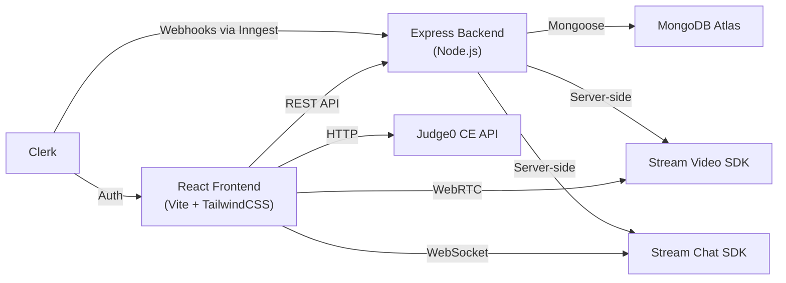
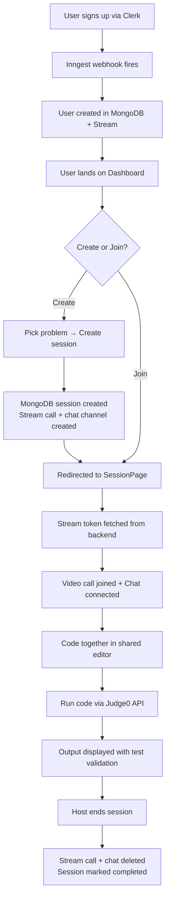

# Devello — Project Explanation

## One-liner
Devello is a **real-time collaborative coding interview platform** where two people can join a session, solve coding problems together in a shared code editor, video call each other, and chat — all in the browser.

---

## Architecture Overview

| Layer | What it does |
|-------|-------------|
| **Frontend** | React SPA with Vite, TailwindCSS, DaisyUI |
| **Backend** | Express REST API with MongoDB |
| **Auth** | Clerk handles sign-in/sign-up, Inngest syncs users to DB |
| **Real-time** | Stream Video (video calls) + Stream Chat (messaging) |
| **Code execution** | Judge0 CE API runs code remotely |

---

## Backend — What I Built

### Database Models

**User** (`models/User.js`)
- Stores `name`, `email`, `profileImage`, `clerkId`
- Created automatically when a user signs up via Clerk webhooks

**Session** (`models/Session.js`)
- Stores `problem`, `difficulty` (easy/medium/hard), `host` (ref to User), `participant` (ref to User), `status` (active/completed), `callId` (Stream video call ID)
- Has timestamps for tracking when sessions were created/updated

### Authentication Middleware (`middleware/protectRoute.js`)
- Uses Clerk's `requireAuth()` to verify JWT tokens
- Looks up the user in MongoDB using their Clerk ID
- Attaches the full user object to `req.user` for downstream controllers

### API Controllers

**Session Controller** (`controllers/sessionController.js`) — 5 endpoints:
1. **Create Session** — Creates a MongoDB session, a Stream video call (with `created_by_id`), and a Stream chat channel
2. **Get Active Sessions** — Fetches all sessions with `status: "active"`, populated with host/participant info
3. **Get My Recent Sessions** — Fetches completed sessions where user was host or participant
4. **Get Session By ID** — Fetches a single session with populated user data
5. **Join Session** — Adds the user as a participant and adds them to the Stream chat channel
6. **End Session** — Deletes the Stream call and chat channel, marks session as "completed"

**Chat Controller** (`controllers/chatController.js`):
- **Get Stream Token** — Generates a Stream authentication token for the current user (used by the frontend to connect to video/chat)

### Inngest Webhooks (`lib/inngest.js`)
- **`clerk/user.created`** — When a user signs up via Clerk, Inngest automatically creates a User document in MongoDB AND upserts a Stream user
- **`clerk/user.deleted`** — Cleans up both MongoDB and Stream when a user is deleted
- This means user management is fully automated — no manual signup API needed

### Stream Setup (`lib/stream.js`)
- Initializes both `StreamChat` (for messaging) and `StreamClient` (for video) with API key + secret
- Exports helper functions: `upsertStreamUser()` and `deleteStreamUser()`

---

## Frontend — What I Built

### Pages (5 total)

**1. HomePage** (`pages/HomePage.jsx`)
- Landing page for unauthenticated users
- Hero section with CTA, feature pills, stats, and feature cards
- Gradient design with DaisyUI theming

**2. DashboardPage** (`pages/DashboardPage.jsx`)
- Main hub after login — shows welcome section, stats cards, active sessions, recent sessions
- "Create Session" modal to pick a problem and start a room
- Auto-redirects unauthenticated users to home

**3. ProblemsPage** (`pages/ProblemsPage.jsx`)
- Browse all coding problems with difficulty filters
- Problems stored as static data with starter code for JS, Python, and Java

**4. ProblemPage** (`pages/ProblemPage.jsx`)
- Solo coding practice page with resizable panels
- Left: problem description, examples, constraints
- Right top: Monaco code editor with language selector
- Right bottom: output panel showing execution results
- Runs code via Judge0 API and validates against expected output
- Triggers confetti animation when all tests pass

**5. SessionPage** (`pages/SessionPage.jsx`)
- The core collaborative experience — resizable 2-panel layout
- Left panel: problem description + code editor + output (stacked vertically)
- Right panel: video call + chat
- Auto-joins the session if user isn't already a participant
- Host can end the session; participants get redirected when it ends

### Components (10 total)

| Component | What it does |
|-----------|-------------|
| **Navbar** | Top navigation with logo, user button (Clerk), sign-in/out |
| **WelcomeSection** | Dashboard greeting with "Create Session" button (responsive) |
| **StatsCards** | Shows active session count and total session count |
| **ActiveSessions** | Lists live sessions with join/rejoin buttons, full/open badges |
| **RecentSessions** | Grid of past sessions with time-ago formatting (date-fns) |
| **CreateSessionModal** | Modal to select a problem and create a new session |
| **CodeEditorPanel** | Monaco editor with language selector and run button |
| **OutputPanel** | Displays code execution output (success in green, errors in red) |
| **ProblemDescription** | Problem details with examples, constraints, difficulty badge |
| **VideoCallUI** | Stream video layout + call controls + toggleable chat sidebar |

### Custom Hooks

**`useStreamClient`** (`hooks/useStreamClient.js`)
- Fetches a Stream token from the backend
- Initializes the Stream Video client and joins the call
- Initializes Stream Chat client and watches the channel
- Handles cleanup on unmount (leave call, disconnect clients)

**`useSessions`** (`hooks/useSessions.js`)
- React Query hooks for all session operations: `useCreateSession`, `useActiveSessions`, `useMyRecentSessions`, `useSessionById`, `useJoinSession`, `useEndSession`

### Code Execution (`lib/judge0.js`)
- Sends code to Judge0 CE's free public API
- Handles JavaScript, Python, and Java (with correct language IDs)
- Returns a consistent `{ success, output, error }` interface
- Originally used Piston API, switched to Judge0 after Piston went whitelist-only

---

## User Flow (How It All Connects)

---

## Key Technical Decisions

| Decision | Why |
|----------|-----|
| **Clerk + Inngest** for auth | Clerk handles auth UI, Inngest automatically syncs users to DB via webhooks — no manual signup API needed |
| **Stream SDK** for video/chat | Production-grade WebRTC without building a signaling server. Server-side token auth keeps it secure |
| **Judge0 CE** for code execution | Free, open API with no key required. Switched from Piston after it went whitelist-only |
| **React Query** for data fetching | Automatic caching, background refetching (sessions poll every 5s), and mutation handling |
| **Resizable panels** | `react-resizable-panels` gives users control over their workspace layout |
| **Monaco Editor** | Same editor as VS Code — syntax highlighting, IntelliSense, multi-language support |
